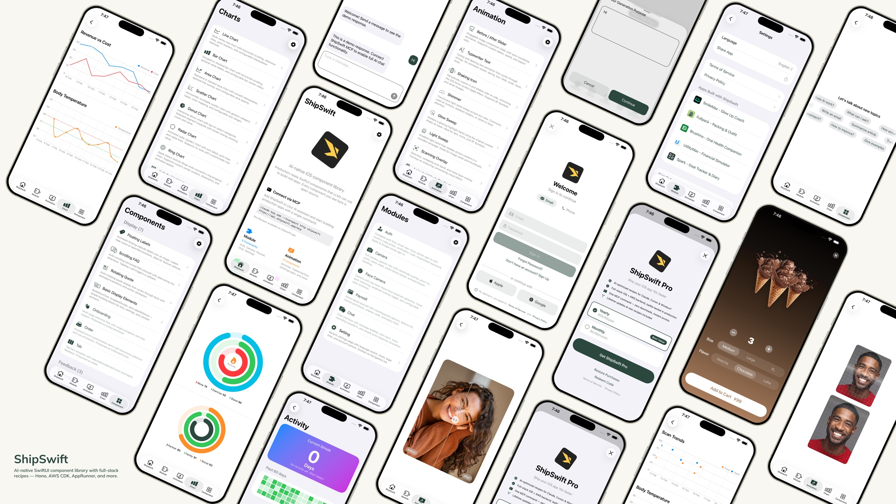

# ShipSwift

<div align="center">



**AI-native SwiftUI component library — production-ready code that LLMs can use to build real apps.**

[](https://shipswift.app)
[](https://apps.apple.com/us/app/shipswift-mcp-codebase/id6759209764)
[](https://opensource.org/licenses/MIT)
[](https://swift.org)
[](https://developer.apple.com/ios/)
[](https://github.com/signerlabs/shipswift-skills)
[](https://glama.ai/mcp/servers/signerlabs/ShipSwift)

[Quick Start](#quick-start) · [Components](#components) · [Custom Dev — $5K, 4 weeks](#need-a-custom-app-built-we-do-that-too) · [Skills](#skills)

</div>

## What is ShipSwift?

One command gives your AI everything it needs — production-ready SwiftUI components, full-stack skills, and the context to build real apps without guessing.

> **Browse every skill live at [shipswift.app/skills](https://shipswift.app/skills)** — searchable catalog, copy-paste source, live previews.

Download the [Showcase App](https://apps.apple.com/us/app/shipswift-mcp-codebase/id6759209764) to preview every component on your device.

## Need a custom app built? We do that too.

ShipSwift gets your AI 80% of the way. If you need the last 20% — your unique features, your brand, your backend — wired up by the people who wrote the skills, **we ship it for you**.

| | |
|---|---|
| ⚡ **48-hour demo** | Working prototype on your TestFlight within 2 days of brief |
| 🚀 **4-week delivery** | Production-ready iOS app, App Store-submission ready |
| 💵 **From $5,000** | Fixed price, milestone-billed, no hourly surprises |

Built on the same component library you see in this repo, so you keep ownership and can extend forever.

**Get a quote:** [wei@signerlabs.com](mailto:wei@signerlabs.com) · [shipswift.app](https://shipswift.app)

## Quick Start

### Option 1: Skills + MCP Server (Recommended)

**Step 1** — Install ShipSwift Skills:

```bash
npx skills add signerlabs/shipswift-skills
```

**Step 2** — Connect the MCP server so your AI can fetch skills:

```bash
# Claude Code
claude mcp add --transport http shipswift https://api.shipswift.app/mcp

# Gemini CLI
gemini mcp add --transport http shipswift https://api.shipswift.app/mcp
```

For Cursor, VS Code Copilot, Windsurf, and other tools, see the [Skills repo](https://github.com/signerlabs/shipswift-skills) for MCP setup.

**Step 3** — Ask your AI:
- "Add a shimmer loading animation"
- "Build an authentication flow with Cognito"
- "Show me all chart components"

### Option 2: Local Skills (No MCP Required)

Install skills that read source files directly from this repo — works offline, no server needed:

```bash
npx skills add signerlabs/ShipSwift
```

Your AI can then browse the component catalog and read source code locally. Try:
- "Explore ShipSwift skills"
- "Add a shimmer animation"
- "Build a chat feature"

> **Tip**: If you also connect the MCP server (Option 1), your AI gets access to additional Pro skills (backend guides, compliance templates, pitfall docs).

### Option 3: File Copy

1. Clone this repository
2. Copy the files you need from `ShipSwift/SWPackage/` into your Xcode project
3. Each component in `SWAnimation/`, `SWChart/`, and `SWComponent/` is self-contained — just copy the file and `SWUtil/` if needed

### Run the Showcase App

```bash
git clone https://github.com/signerlabs/ShipSwift.git
cd ShipSwift
open ShipSwift.xcodeproj
```

Select a simulator or device, then press **Cmd+R** to build and run.

## Components

### SWAnimation — Animation Components

**SwiftUI animations:** [Shimmer](https://shipswift.app/skills/animation-shimmer) · [TypewriterText](https://shipswift.app/skills/animation-typewriter-text) · [ShakingIcon](https://shipswift.app/skills/animation-shaking-icon) · [GlowSweep](https://shipswift.app/skills/animation-glow-sweep) · [LightSweep](https://shipswift.app/skills/animation-light-sweep) · [ScanningOverlay](https://shipswift.app/skills/animation-scanning-overlay) · [AnimatedMeshGradient](https://shipswift.app/skills/animation-animated-mesh-gradient) · [BeforeAfterSlider](https://shipswift.app/skills/animation-before-after-slider) · [OrbitingLogos](https://shipswift.app/skills/animation-orbiting-logos) · [FullScreenButton](https://shipswift.app/skills/animation-full-screen-button) · [ChangeEffect](https://shipswift.app/skills/animation-change-effect) · [Confetti](https://shipswift.app/skills/animation-confetti) · [Transition](https://shipswift.app/skills/animation-transition) · [ParticleTransition](https://shipswift.app/skills/animation-particle-transition)

**Canvas-rendered 3D:** [DotSphere](https://shipswift.app/skills/dot-sphere) · [CharSphere](https://shipswift.app/skills/animation-char-sphere)

**Metal-shader procedural backgrounds:** [Dots](https://shipswift.app/skills/dots) · [Starfield](https://shipswift.app/skills/animation-starfield) · [FractalClouds](https://shipswift.app/skills/animation-fractal-clouds) · [InkSmoke](https://shipswift.app/skills/animation-ink-smoke) · [LiquidChrome](https://shipswift.app/skills/animation-liquid-chrome) · [Plasma](https://shipswift.app/skills/animation-plasma) · [AnimatedLoop](https://shipswift.app/skills/animation-animated-loop)

**Metal-shader backgrounds:** [Metaballs](https://shipswift.app/skills/metaballs) · [Halftone](https://shipswift.app/skills/animation-halftone) · [Water](https://shipswift.app/skills/animation-water) · [LiquidMetal](https://shipswift.app/skills/animation-liquid-metal) · [NeuroNoise](https://shipswift.app/skills/neuro-noise-simplex-noise) · [DotOrbit](https://shipswift.app/skills/dot-orbit-wallet) · [Voronoi](https://shipswift.app/skills/voronoi-swirl) · [SimplexNoise](https://shipswift.app/skills/neuro-noise-simplex-noise) · [ColorPanels](https://shipswift.app/skills/color-panels) · [SmokeRing](https://shipswift.app/skills/animation-smoke-ring) · [Swirl](https://shipswift.app/skills/voronoi-swirl) · [StarNest](https://shipswift.app/skills/star-nest) · [GrainGradient](https://shipswift.app/skills/animation-grain-gradient)

**Metal-shader effects on any view:** [Foil](https://shipswift.app/skills/animation-foil) · [Glitter](https://shipswift.app/skills/glitter) · [IntenseBling](https://shipswift.app/skills/animation-intense-bling) · [PolishedAluminum](https://shipswift.app/skills/animation-polished-aluminum) · [ChromaticGlass](https://shipswift.app/skills/animation-chromatic-glass) · [Glass](https://shipswift.app/skills/animation-glass) · [GlassOrb](https://shipswift.app/skills/animation-glass-orb) · [GlassLogo](https://shipswift.app/skills/glass-logo)

44 animation components total — see the [Showcase App](https://apps.apple.com/us/app/shipswift-mcp-codebase/id6759209764) for live previews.

### SWChart — Chart Components

[LineChart](https://shipswift.app/skills/chart-line-chart) · [BarChart](https://shipswift.app/skills/chart-bar-chart) · [AreaChart](https://shipswift.app/skills/chart-area-chart) · [DonutChart](https://shipswift.app/skills/chart-donut-chart) · [RingChart](https://shipswift.app/skills/chart-ring-chart) · [RadarChart](https://shipswift.app/skills/chart-radar-chart) · [ScatterChart](https://shipswift.app/skills/chart-scatter-chart) · [ActivityHeatmap](https://shipswift.app/skills/chart-activity-heatmap) · [NetworkGraph](https://shipswift.app/skills/network-graph)

### SWComponent — UI Components

**Display:** [FloatingLabels](https://shipswift.app/skills/component-floating-labels) · [ScrollingFAQ](https://shipswift.app/skills/component-scrolling-faq) · [RotatingQuote](https://shipswift.app/skills/component-rotating-quote) · [BulletPointText](https://shipswift.app/skills/component-bullet-point-text) · [GradientDivider](https://shipswift.app/skills/component-gradient-divider) · [Label](https://shipswift.app/skills/component-label) · [MarkdownText](https://shipswift.app/skills/component-markdown-text) · [OnboardingView](https://shipswift.app/skills/onboarding-view) · [OrderView](https://shipswift.app/skills/component-order-view) · [RootTabView](https://shipswift.app/skills/component-root-tab-view) · [VideoPlayer](https://shipswift.app/skills/component-video-player) · [CachedImage](https://shipswift.app/skills/component-cached-image) · [ImageThumbnail](https://shipswift.app/skills/component-image-thumbnail) · [KPICard](https://shipswift.app/skills/component-kpi-card) · [StatusBadge](https://shipswift.app/skills/component-status-badge) · [Wallet](https://shipswift.app/skills/dot-orbit-wallet)
**Feedback:** [Alert](https://shipswift.app/skills/component-alert) · [Loading](https://shipswift.app/skills/component-loading) · [ThinkingIndicator](https://shipswift.app/skills/component-thinking-indicator)
**Input:** [TabButton](https://shipswift.app/skills/component-tab-button) · [Stepper](https://shipswift.app/skills/component-stepper) · [AddSheet](https://shipswift.app/skills/component-add-sheet) · [SearchBar](https://shipswift.app/skills/component-search-bar)

### SWModule — Multi-File Frameworks

- **[SWAuth](https://shipswift.app/skills/auth-cognito)** — User authentication (Amplify/Cognito, social login, email/password, phone sign-in with country code picker)
- **[SWCamera](https://shipswift.app/skills/camera)** — Camera capture with viewfinder, zoom, photo picker, and face detection with Vision landmark tracking
- **[SWPaywall](https://shipswift.app/skills/subscription-storekit)** — Subscription paywall using StoreKit 2 — *iOS client included free. Full-stack skill (backend + compliance + pitfalls) → [Pro](https://shipswift.app/#pricing)*
- **[SWChat](https://shipswift.app/skills/chat)** — All-in-one chat view with message list, text input, and optional voice recognition (VolcEngine ASR)
- **[SWSetting](https://shipswift.app/skills/setting)** — Settings page template with language switch, share, legal links, recommended apps
- **[SWSubjectLifting](https://shipswift.app/skills/subject-lifting)** — Background removal using VisionKit ImageAnalysis
- **[SWTikTokTracking](https://shipswift.app/skills/tiktok-tracking)** — TikTok Events API integration for attribution tracking — *iOS client included free. Full-stack skill (backend + compliance + pitfalls) → [Pro](https://shipswift.app/#pricing)*

### SWUtil — Shared Utilities

DebugLog · String/Date/View extensions · LocationManager

## Directory Structure

```
ShipSwift/
├── SWPackage/
│   ├── SWAnimation/          # Animation components
│   ├── SWChart/              # Chart components
│   ├── SWComponent/          # UI components
│   │   ├── Display/          #   Display components
│   │   ├── Feedback/         #   Feedback components
│   │   └── Input/            #   Input components
│   ├── SWModule/             # Multi-file frameworks
│   │   ├── SWAuth/           #   Authentication
│   │   ├── SWCamera/         #   Camera + face detection
│   │   ├── SWPaywall/        #   Subscription paywall
│   │   ├── SWChat/           #   Chat + voice input
│   │   ├── SWSetting/        #   Settings page
│   │   ├── SWSubjectLifting/ #   Background removal
│   │   └── SWTikTokTracking/ #   TikTok attribution
│   └── SWUtil/               # Shared utilities
├── View/                     # Showcase app views
├── Service/                  # App services
└── Component/                # Shared app components
```

## Naming Convention

All types use the `SW` prefix (e.g., `SWAlertManager`, `SWStoreManager`).
View modifiers use `.sw` lowercase prefix (e.g., `.swAlert()`, `.swPageLoading()`, `.swPrimary`).

## Dependency Rules

```
SWUtil        ← no dependencies on other SWPackage directories
SWAnimation   ← may depend on SWUtil only
SWChart       ← may depend on SWUtil only
SWComponent   ← may depend on SWUtil only
SWModule      ← may depend on SWUtil and SWComponent
```

## Skills

ShipSwift provides **free and Pro skills** — each skill includes complete SwiftUI source code, implementation steps, and best practices. Your AI assistant can retrieve any skill on demand.

| Category | Examples |
|----------|----------|
| Animation | Shimmer, Typewriter, Orbiting Logos |
| Chart | Line, Bar, Donut, Radar, Heatmap |
| Component | Alert, Onboarding, Stepper, FAQ |
| Module | Auth, Camera, Chat, Setting, Infra CDK, Subscription\*, TikTok Tracking\*, Export & Share\* |

\* Pro skills — include full backend, compliance templates, and pitfall guides. *Coming soon: Push Notifications, Analytics Dashboard.*

Three tools are available: `listSkills`, `getSkill`, `searchSkills`.

Learn more at [shipswift.app](https://shipswift.app) · Skills repo: [signerlabs/shipswift-skills](https://github.com/signerlabs/shipswift-skills)

## Free vs Pro

All iOS client code is open-source under the MIT license. Pro skills add everything you need to go from prototype to production.

| | Free (Open Source) | Pro Skill |
|---|---|---|
| iOS client code | Full source | Enhanced version |
| Backend implementation | — | Hono routes, DB schema, webhooks |
| Integration guides | — | End-to-end setup checklists |
| Compliance templates | — | Privacy manifest, App Store labels |
| Known pitfalls | — | 10+ battle-tested tips per skill |

See [pricing](https://shipswift.app/#pricing) for details.

## Tech Stack

- SwiftUI + Swift
- StoreKit 2
- Amplify SDK (Cognito)
- AVFoundation + Vision
- SpriteKit
- VolcEngine ASR

## Contributing

Contributions are welcome! Please follow these steps:

1. Fork the repository
2. Create a feature branch (`git checkout -b feature/amazing-feature`)
3. Commit your changes (`git commit -m 'Add amazing feature'`)
4. Push to the branch (`git push origin feature/amazing-feature`)
5. Open a Pull Request

### Code Style

- All comments and documentation in English
- Follow the naming conventions, dependency rules, and self-containment described above

## License

This project is licensed under the MIT License — see the [LICENSE](LICENSE) file for details.
